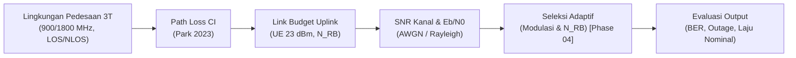
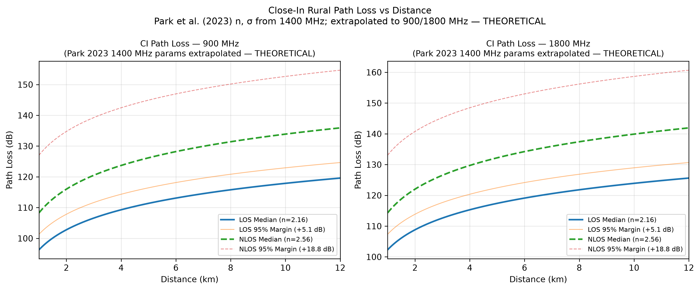
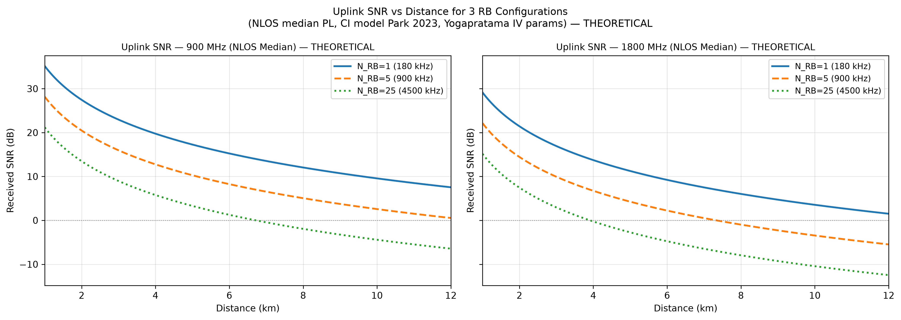
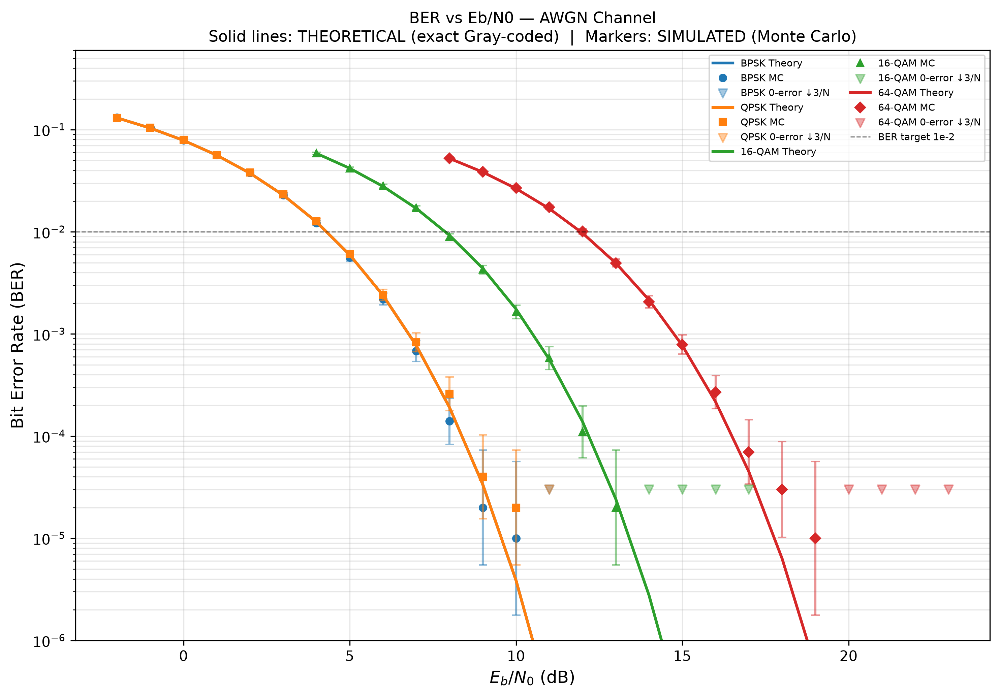
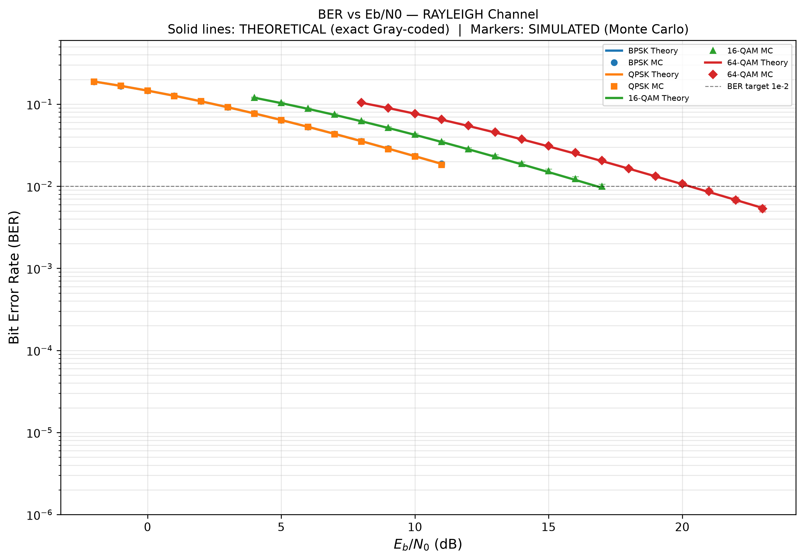

<div align="center">


# RuralLink

### Adaptive Uplink Coverage Simulator

*Simulator link-level yang dapat direproduksi untuk menganalisis batas jangkauan uplink dan alokasi modulasi–bandwidth adaptif pada frekuensi 900/1800 MHz di wilayah 3T Indonesia.*

**Extending reach. Preserving reliability.**

**Proyek Kelompok 1 — Sistem Komunikasi Digital (2026)** | Dosen Pengampu: **Bu Dessy**


*Snapshot: `2026-11-25` | Baseline commit: `88a1828` | Jadwal presentasi: `26 November 2026, 15.00 WIB`*

[Mulai Baca](#baca-ini-dulu) | [Masalah](#permasalahan-telekomunikasi-indonesia) | [Solusi](#solusi-yang-diusulkan) | [Metode](#metodologi-singkat) | [Hasil](#hasil-dan-validasi-ilmiah) | [Simulator](#simulator-dan-demo) | [Tim](#hasil-kerja-dan-pembagian-tim) | [Referensi](#landasan-literatur) | [Dokumentasi](#dokumentasi-dan-tata-kelola)

</div>

---

## Baca Ini Dulu

**RuralLink** adalah simulator perangkat lunak ilmiah (*link-level simulator*) berbasis Python untuk mengevaluasi batas jangkauan komunikasi *uplink* (perangkat pengguna ke menara BTS) pada skenario pedesaan berdaya pancar terbatas. RuralLink **bukan** BTS fisik, produk komersial, maupun implementasi penuh protokol LTE/5G-NR.

- **Mengapa masalah ini penting?** Di wilayah Terdepan, Terluar, dan Tertinggal (3T) Indonesia, cakupan geografis masih tertinggal jauh dibanding cakupan populasi. Pada sel pedesaan yang luas, daya pancar perangkat pengguna (UE) jauh lebih kecil daripada BTS, sehingga arah *uplink* sering kali lebih dulu mengalami kegagalan koneksi.
- **Apa solusi yang diusulkan?** Mengombinasikan **modulasi adaptif** (`BPSK`, `QPSK`, `16-QAM`, `64-QAM`) dan **alokasi bandwidth adaptif** berbasis *Resource Block* (`1, 2, 5, 10, 25` RB) pada frekuensi `900 MHz` dan `1800 MHz`.
- **Apa yang sudah selesai?** Mesin simulasi ilmiah (`src/`), optimasi adaptif gabungan S0–S3 + referensi R0 (`src/adaptive.py`), audit Fase 06, antarmuka web Streamlit (`app.py`), 93 pengujian otomatis (`pytest` + `AppTest`), serta grafik, CSV tervalidasi, dan ringkasan di `outputs/summary.md`.
- **Apa yang masih pending?** Publikasi live ke Streamlit Community Cloud (menunggu otorisasi push/deploy akhir) dan presentasi.

### Jalur Baca Cepat Berdasarkan Peran
| Peran | Dokumen Utama | Tujuan |
|---|---|---|
| **Semua Anggota** | [docs/START_HERE.md](docs/START_HERE.md) & [docs/RESEARCH_OVERVIEW.md](docs/RESEARCH_OVERVIEW.md) | Memahami konteks penelitian dalam 5–15 menit |
| **Tim PPT** | [docs/TEAM_HANDOFF.md](docs/TEAM_HANDOFF.md) & [docs/PRESENTATION_GUIDE.md](docs/PRESENTATION_GUIDE.md) | Menyusun alur slide, klaim terverifikasi, dan persiapan Q&A |
| **Tim Analisis** | [docs/RESULTS_GUIDE.md](docs/RESULTS_GUIDE.md) & [docs/TEAM_HANDOFF.md](docs/TEAM_HANDOFF.md) | Membaca CSV, grafik, batas kepercayaan, dan batasan ilmiah |
| **Developer (Aditya & Zahran)** | [docs/DEVELOPER_GUIDE.md](docs/DEVELOPER_GUIDE.md) & [docs/ARCHITECTURE.md](docs/ARCHITECTURE.md) | Menjalankan environment, tes, dan melanjutkan Fase 04–05 |

---

## Permasalahan Telekomunikasi Indonesia

Berdasarkan **Laporan Kinerja Kementerian Komdigi 2025** (hal. 104–105, data Q2 2025), cakupan jaringan 4G di Indonesia mencapai **98,95% populasi** (`267,21 juta` penduduk) dan **99,23% wilayah permukiman**, tetapi baru menjangkau **53,82% luas wilayah daratan** (`1.022.161,15 km²`). *Catatan: statistik ini adalah data historis 2025, bukan pengukuran real-time; selisih 46,18% luas daratan tidak berarti 46,18% penduduk tidak memiliki sinyal.*

Pada wilayah 3T dengan kepadatan penduduk rendah dan jarak antar-menara yang jauh, biaya pembangunan BTS sangat tinggi sehingga sel harus melayani radius yang luas. Kondisi ini memicu **ketimpangan *uplink–downlink*** (*ILLUSTRATIVE*):

| Parameter | Downlink (BTS → UE) | Uplink (UE → BTS) | Selisih / Implikasi |
|---|---|---|---|
| Daya pancar tipikal | `43 dBm` (~20 W) | `23 dBm` (~0,2 W) | **20 dB lebih rendah** di *uplink* |
| Dampak pada sel luas | Sinyal *downlink* masih dapat terbaca | Sinyal *uplink* lebih cepat teredam | Sinyal terlihat ada, tetapi unggah/panggilan gagal |

*(Catatan: perbandingan daya pancar 20 dB bersifat ilustratif; performa tautan penuh juga bergantung pada penguatan antena, noise figure penerima, dan rugi-rugi saluran.)*

---

## Pertanyaan dan Tujuan Penelitian

**Tema Resmi:** *Keandalan dan Perluasan Jangkauan Sistem Komunikasi Digital pada Wilayah Terdepan, Terluar, dan Tertinggal (3T) Indonesia dengan Keterbatasan Daya Uplink.*

**Judul Resmi:** *Analisis Peningkatan Jangkauan Uplink melalui Modulasi Adaptif dan Alokasi Bandwidth pada Frekuensi 900 MHz dan 1800 MHz di Wilayah 3T Indonesia.*

**Pertanyaan Penelitian:** Bagaimana pengaruh kombinasi modulasi adaptif dan alokasi *bandwidth* terhadap keandalan *uplink*, laju data nominal, dan estimasi jangkauan andal pada skenario pedesaan dengan keterbatasan daya?

**Tujuan Penelitian:**
1. Menganalisis pengaruh frekuensi (`900 MHz` vs `1800 MHz`) dan jarak terhadap *path loss* serta SNR *uplink*.
2. Memodelkan propagasi pedesaan kondisi *Line-of-Sight* (LOS) dan *Non-Line-of-Sight* (NLOS).
3. Memvalidasi kurva *Bit Error Rate* (BER) modulasi digital (`BPSK`, `QPSK`, `16-QAM`, `64-QAM`) secara teoretis dan simulasi Monte Carlo *bit-level*.
4. Membandingkan konfigurasi tetap (*fixed*) dan adaptif (*planned* di Fase 04).
5. Mengevaluasi *trade-off* antara keandalan, laju data nominal, dan jangkauan.

---

## Landasan Literatur

| Referensi | Publikasi | Masalah Asli | Metode | Kontribusi ke RuralLink | Keterbatasan |
|---|---|---|---|---|---|
| **Reddy et al. (2022)** *(Utama)* | *EURASIP J. Wirel. Commun. Netw.* (`10.1186/s13638-022-02133-3`) | Cakupan *uplink* pada sel pedesaan sangat luas (*extremely large-cell*) | Link budget *uplink*, konsentrasi daya per PRB, margin *shadowing* 95% | Model daya UE tetap `23 dBm` per alokasi RB (`180 kHz`/RB) & margin `1,645σ` | Evaluasi asli di 700 MHz dengan 16 antena BS & HARQ; disederhanakan di RuralLink |
| **Khan et al. (2025)** | *Scientific Reports* (`10.1038/s41598-025-16743-6`) | Optimasi modulasi adaptif pada kanal nirkabel | *Threshold-based adaptive modulation* pada target $\text{BER} = 10^{-2}$ | Target $\text{BER} = 10^{-2}$ dan kerangka pergantian modulasi | Model asli untuk *downlink* 2 GHz; Pers. (11)/(14) adalah SER sehingga tidak disalin langsung (lihat D10) |
| **Park et al. (2023)** | *IEEE Wirel. Commun. Lett.* (`10.1109/LWC.2023.3273280`) | Pemodelan *path loss* jarak jauh di pedesaan | Kampanye pengukuran & model *Close-In* (CI) dengan difraksi | Persamaan CI & parameter LOS ($n=2{,}16, \sigma=3{,}07$) / NLOS ($n=2{,}56, \sigma=11{,}40$) | Data diukur di Korea Selatan pada 1400 MHz dan diekstrapolasi ke 900/1800 MHz |
| **Yogapratama et al. (2015)** | Prosiding Konferensi (`10.1109/ICoICT.2015.7231410`) | Perencanaan jaringan LTE 900/1800 MHz di pedesaan | Perhitungan *link budget* & radius sel | Parameter perangkat keras *uplink* Tabel IV (`5 MHz`, `G_r=11 dBi`, `NF=4 dB`, dll.) | Publikasi konferensi; akses lokal hanya berupa gambar/tabel (kepengarangan belum terverifikasi penuh) |
| **Komdigi (2025)** | *Laporan Kinerja KOMDIGI 2025* (hal. 104–105, 108) | Kesenjangan cakupan infrastruktur digital nasional | Statistik cakupan 4G & BTS 3T | Motivasi kesenjangan cakupan populasi (98,95%) vs wilayah (53,82%) | Data makro nasional, bukan parameter propagasi RF |

---

## Solusi yang Diusulkan

RuralLink menggabungkan dua mekanisme adaptasi pada *uplink*:

1. **Modulasi Adaptif (`BPSK`, `QPSK`, `16-QAM`, `64-QAM`):**
   - Pada kondisi SNR tinggi (dekat BTS), sistem memilih `64-QAM` (6 bit/simbol) untuk laju data nominal tinggi.
   - Pada kondisi SNR rendah (jauh dari BTS), sistem beralih ke `BPSK` (1 bit/simbol) yang lebih tahan derau.
   - *Catatan:* Modulasi adaptif **tidak** memperbesar daya terima maupun mengurangi *path loss*; ia hanya menyesuaikan ketahanan deteksi terhadap derau.
2. **Alokasi Bandwidth Adaptif (`1, 2, 5, 10, 25` RB × `180 kHz`):**
   - Di bawah asumsi daya pancar total UE tetap (`23 dBm`), mempersempit *bandwidth* aktif (mengurangi jumlah RB) menurunkan daya derau termal penerima ($N = -174 + 10\log_{10}(B_{\text{active}}) + \mathrm{NF}$).
   - Akibatnya, SNR meningkat sehingga jangkauan andal bertambah, dengan konsekuensi penurunan laju data nominal maksimum.
   - *Catatan:* Konsentrasi daya ini berlaku pada model *power-limited* yang diasumsikan, bukan pada semua kondisi *power control* jaringan nyata.



---

## Metodologi Singkat

Rantai matematis lengkap terdokumentasi di [docs/METHODOLOGY.md](docs/METHODOLOGY.md):
- **Path Loss CI (`src/propagation.py`):** $\mathrm{PL}(f_{\text{GHz}}, d_m) = 32{,}4 + 20\log_{10}(f_{\text{GHz}}) + 10 n \log_{10}(d_m) + X_\sigma$, dengan $X_\sigma \sim \mathcal{N}(0, \sigma^2)$.
- **Link Budget (`src/link_budget.py`):** $P_r = P_t + G_t + G_r - \mathrm{PL} - L_{\text{feeder}} - L_{\text{body}}$; $B_{\text{active}} = N_{\text{RB}} \times 180\text{ kHz}$; $\mathrm{SNR}_{\text{dB}} = P_r - N_{\text{dBm}}$.
- **Energi & Laju Nominal:** $E_s/N_0 = \mathrm{SNR}_{\text{linear}}$, $E_b/N_0 = \mathrm{SNR}_{\text{linear}} / k$, dan $R_b = B_{\text{active}} \cdot k$.
- **BER Teoretis & Simulasi (`src/modulation.py`, `src/channels.py`, `src/metrics.py`):** BER eksak Cho–Yoon (2002) untuk $M$-QAM di AWGN, integrasi numerik untuk Rayleigh, serta simulasi Monte Carlo *bit-level* dengan interval kepercayaan Wilson 95%.
- **Optimasi Adaptif (`src/adaptive.py`):** *Pending (Fase 04)* — pemilihan $(M, N_{\text{RB}})$ yang memenuhi $\mathrm{BER} \le 0{,}01$ dengan $P_{\text{out}} \le 0{,}05$.

<details>
<summary>Tabel Parameter Default (<code>config.py</code>)</summary>

| Parameter | Nilai Default | Satuan | Sumber |
|---|---|---|---|
| Frekuensi pembawa ($f_c$) | `900`, `1800` | MHz | Ruang lingkup penelitian |
| Bandwidth kanal nominal | `5.0e6` (`5`) | Hz (MHz) | Yogapratama Tabel IV |
| Kandidat RB ($N_{\text{RB}}$) | `1, 2, 5, 10, 25` | RB | Grid sub-band ($\le 4{,}5\text{ MHz}$) |
| Bandwidth per RB | `180,000` | Hz | LTE PRB (Reddy Tabel 1) |
| Daya pancar UE ($P_t$) | `23.0` | dBm | Yogapratama / Reddy |
| Gain antena UE / BTS | `0.0` / `11.0` | dBi | Yogapratama Tabel IV |
| Feeder loss / Body loss | `5.0` / `3.0` | dB | Yogapratama Tabel IV |
| Noise figure penerima | `4.0` | dB | Yogapratama Tabel IV |
| Parameter CI LOS / NLOS | $n=2{,}16, \sigma=3{,}07$ / $n=2{,}56, \sigma=11{,}40$ | — / dB | Park (2023) Tabel II |
| Target BER / Outage | `0.01` / `0.05` | — | Khan (2025) / Target 95% |
| Jarak evaluasi & Seed | `1.0 – 12.0` km, `seed=42` | km / — | `config.py` |

</details>

---

## Desain Eksperimen

Kerangka perbandingan (*ablation study*) yang direncanakan untuk **Fase 04 (Pending)** menggunakan realisasi kanal identik (*paired random seeds*):
- **S0 (Baseline Fixed):** Modulasi tetap dan bandwidth tetap (mis. `QPSK` + `25 RB`).
- **S1 (Adaptive Modulation Only):** Modulasi adaptif + bandwidth tetap (`25 RB`).
- **S2 (Adaptive Bandwidth Only):** Modulasi tetap + bandwidth adaptif (`1–25 RB`).
- **S3 (Joint Adaptive):** Modulasi adaptif + bandwidth adaptif secara bersamaan.
- **Referensi Ketahanan Maksimum:** `BPSK` + `1 RB`.

---

## Hasil dan Validasi Ilmiah

Seluruh hasil di bawah ini berasal dari **Fase 02–03** yang telah tervalidasi (`pytest` 77/77 lulus). Hasil komparatif S0–S3 (Fase 04) belum dijalankan.

### 1. Validasi Path Loss & Link Budget (**THEORETICAL**)
| Pemeriksaan Matematis | Nilai Terverifikasi | Keterangan |
|---|---|---|
| Selisih *path loss* 900 vs 1800 MHz | **6,0206 dB** | $20\log_{10}(2)$ pada $n$ yang sama |
| Kenaikan SNR $25 \to 1$ RB | **13,9794 dB** | $10\log_{10}(25)$ pada daya UE tetap |
| Kenaikan SNR $25 \to 5$ RB | **6,9897 dB** | $10\log_{10}(5)$ pada daya UE tetap |
| Noise floor $N_{\text{RB}}=1$ | **−117,447 dBm** | $-174 + 10\log_{10}(180{.}000) + 4$ |


*`outputs/figures/path_loss_vs_distance.png` — Menunjukkan path loss CI median dan margin 95% untuk 900/1800 MHz (LOS/NLOS). Tidak dapat disimpulkan sebagai pengukuran lapangan Indonesia. Data: [link_budget_validation.csv](outputs/results/link_budget_validation.csv).*


*`outputs/figures/uplink_snr_vs_distance.png` — Menunjukkan penurunan SNR terhadap jarak untuk $N_{\text{RB}} \in \{1, 5, 25\}$. Memperkecil $N_{\text{RB}}$ menggeser kurva SNR ke atas secara teoretis. Data: [link_budget_validation.csv](outputs/results/link_budget_validation.csv).*

### 2. Validasi BER Modulasi Digital (**THEORETICAL + SIMULATED**)
Ambang batas pergantian modulasi pada $\text{BER} = 10^{-2}$ di kanal AWGN ([modulation_thresholds.csv](outputs/results/modulation_thresholds.csv)):
- **BPSK:** $E_b/N_0 = 4{,}32\text{ dB}$, $E_s/N_0 = 4{,}32\text{ dB}$
- **QPSK:** $E_b/N_0 = 4{,}32\text{ dB}$, $E_s/N_0 = 7{,}33\text{ dB}$
- **16-QAM:** $E_b/N_0 = 7{,}88\text{ dB}$, $E_s/N_0 = 13{,}90\text{ dB}$
- **64-QAM:** $E_b/N_0 = 11{,}95\text{ dB}$, $E_s/N_0 = 19{,}74\text{ dB}$

*(Catatan: $E_b/N_0$ berbeda dari SNR sesaat; untuk $M > 2$, $E_s/N_0 = E_b/N_0 + 10\log_{10}(k)$.)*


*`outputs/figures/ber_awgn_validation.png` — Kurva teoretis Cho–Yoon vs simulasi Monte Carlo bit-level di kanal AWGN (kesalahan relatif BPSK $\approx 0{,}3\%$ pada $\text{BER} \approx 1{,}25\times 10^{-2}$). Data: [ber_validation.csv](outputs/results/ber_validation.csv).*


*`outputs/figures/ber_rayleigh_validation.png` — Kurva teoretis vs simulasi Monte Carlo di kanal Rayleigh fading dengan ekualisasi ZF koheren sempurna. Penurunan BER jauh lebih landai dibanding AWGN. Data: [ber_validation.csv](outputs/results/ber_validation.csv).*

---

## Simulator dan Demo

`app.py` adalah *workbench* Streamlit interaktif yang mengambil seluruh metrik, kurva cakupan, dan sampel konstelasi langsung dari mesin Python (`src/`).
- **Kebutuhan perangkat keras:** Laptop/PC standar; berjalan **100% offline** setelah dependensi terpasang (tanpa API eksternal, database, atau PDF lokal).
- **Peluncuran offline cepat (Windows):** jalankan `.\run_local.ps1`.
- **Deployment Streamlit Community Cloud:**
  - **Repository:** `Legorvey/rural-link`
  - **Branch:** `feature/scientific-app`
  - **Main file path:** `app.py`
  - **Python version:** `3.12` (`.python-version`)
  - **Dependencies:** `requirements.txt` (versi Linux-compatible terpin)
- **Urutan Demo Langsung (Live Demo Sequence):**
  1. Buka `app.py` (default: `900 MHz`, `NLOS`, `23 dBm`, jarak `5.0 km`, semua skenario aktif).
  2. Tunjukkan tab **Coverage zones** untuk membandingkan radius deterministik (*median PL*) vs reliabilitas stokastik (*shadowing* & *Rayleigh CSI*).
  3. Ubah frekuensi dari `900 MHz` ke `1800 MHz` di panel kiri untuk memperlihatkan penyempitan jangkauan dan kenaikan outage pada strip telemetri.
  4. Buka tab **Operating points** untuk melihat transisi adaptif modulasi dan *Resource Block* terhadap jarak.
  5. Buka tab **Bit-level validation**, klik **Run Monte Carlo transmission** untuk membuktikan BER *bit-level* serta konstelasi AWGN vs Rayleigh hasil *equalization* secara langsung.
- **Rencana cadangan presentasi:** (A) Aplikasi Streamlit ter-deploy → (B) Aplikasi Streamlit lokal (`.\run_local.ps1`) → (C) Grafik PNG, CSV, dan `outputs/summary.md`.

---

## Quick Start

Perintah untuk **Windows PowerShell** pada repositori hasil *fresh clone* (memerlukan Python 3.12 dan `uv`):

```powershell
git clone https://github.com/Legorvey/rural-link.git
cd rural-link
uv venv --python 3.12 .venv
uv pip install --python .venv\Scripts\python.exe -r requirements-dev.txt
```

Menjalankan tes, *linter*, eksperimen, dan aplikasi:
```powershell
.venv\Scripts\python.exe -m pytest -q
.venv\Scripts\python.exe -m ruff check .
.venv\Scripts\python.exe -m ruff format --check .
.venv\Scripts\python.exe -m experiments.run_experiments
.venv\Scripts\python.exe -m streamlit run app.py
```

---

## Struktur Repository

```text
rural-link/
├── README.md                  # Research hub utama
├── AGENTS.md                  # Instruksi untuk AI agents
├── CONTRIBUTING.md            # Panduan kontribusi dan Git
├── CITATION.cff               # Metadata sitasi proyek
├── config.py                  # Konfigurasi & parameter default tervalidasi
├── app.py                     # Workbench Streamlit interaktif (terhubung ke src/)
├── run_local.ps1              # Skrip peluncuran offline lokal (.venv)
├── src/                       # Mesin simulasi ilmiah + optimasi adaptif (adaptive.py)
├── experiments/               # Skrip eksperimen deterministik (run_experiments.py, run_adaptive.py)
├── tests/                     # 93 pengujian otomatis (unit, ilmiah, & Streamlit AppTest)
├── outputs/                   # Grafik PNG & tabel CSV tervalidasi
├── references/                # PDF referensi lokal (di-gitignore, tidak di-commit)
└── docs/                      # Dokumentasi lengkap tim, metode, dan handoff
```

---

## Hasil Kerja dan Pembagian Tim

Anggota Kelompok 1: **Aditya, Zahran, Baihaqy, Jeyd, Rizqul, Yusril**.

| Workstream | Anggota | Tanggung Jawab | Input | Output | File Terkait |
|---|---|---|---|---|---|
| **Simulasi / Program** | **Aditya, Zahran** | Mesin ilmiah, optimasi adaptif, eksperimen, Streamlit | `METHODOLOGY.md`, `config.py` | Kode `src/`, `app.py`, CSV & grafik | `src/`, `experiments/`, `app.py`, `tests/` |
| **Presentasi / PPT** | *2 anggota (pending konfirmasi)* | Menyusun dek presentasi & alur demo | `TEAM_HANDOFF.md`, `RESULTS_GUIDE.md` | Slide PPT terverifikasi | `outputs/figures/`, `docs/PRESENTATION_GUIDE.md` |
| **Analisis / Laporan** | *2 anggota (pending konfirmasi)* | Interpretasi hasil, diskusi, & kesimpulan | `ber_validation.csv`, `link_budget_validation.csv` | Bab analisis & pembahasan | `outputs/results/`, `docs/RESULTS_GUIDE.md` |

---

## Yang Belum Kita Ketahui

- Tidak ada kalibrasi pengukuran lapangan di wilayah 3T Indonesia; parameter CI berasal dari Korea Selatan (1400 MHz) yang diekstrapolasi.
- Sistem mengasumsikan *Channel State Information* (CSI) sempurna, tanpa *channel coding* (FEC), tanpa interferensi antar-sel, dan tanpa penjadwalan penuh LTE/NR.
- Laju data nominal ($B_{\text{active}} \cdot k$) bukan *throughput* jaringan aktual.
- Jangkauan di luar rentang uji `1–12 km` tidak dievaluasi, dan cakupan geografis nasional tidak dapat disimpulkan dari simulasi *link-level* ini.

---

## Kesimpulan Sementara

1. **Hubungan Teoretis Terkonfirmasi:** Penggandaan frekuensi ($900 \to 1800\text{ MHz}$) menambah *path loss* CI sebesar `6,0206 dB`, dan pengurangan RB ($25 \to 1$) meningkatkan SNR sebesar `13,9794 dB` pada daya UE tetap.
2. **Validasi Simulasi Terkonfirmasi:** Simulasi Monte Carlo *bit-level* untuk `BPSK`, `QPSK`, `16-QAM`, dan `64-QAM` pada kanal AWGN dan Rayleigh cocok dengan kurva teoretis eksak.
3. **Hasil Komparatif & Pertanyaan Tersisa:** Perbandingan S0–S3 (seberapa besar perluasan jangkauan andal oleh optimasi gabungan) masih **pending** hingga Fase 04 dijalankan.

---

## Dokumentasi dan Tata Kelola

| Dokumen | Kegunaan |
|---|---|
| [docs/START_HERE.md](docs/START_HERE.md) | Panduan onboarding cepat untuk seluruh anggota |
| [docs/RESEARCH_OVERVIEW.md](docs/RESEARCH_OVERVIEW.md) | Penjelasan penelitian dalam bahasa yang mudah dipahami |
| [docs/METHODOLOGY.md](docs/METHODOLOGY.md) | Spesifikasi matematis lengkap & persamaan |
| [docs/REFERENCES.md](docs/REFERENCES.md) | Daftar literatur, DOI, dan batasan tiap sumber |
| [docs/ARCHITECTURE.md](docs/ARCHITECTURE.md) | Arsitektur sistem & kontrak fungsi `src/` |
| [docs/DEVELOPER_GUIDE.md](docs/DEVELOPER_GUIDE.md) | Panduan teknis untuk Aditya & Zahran |
| [docs/RESULTS_GUIDE.md](docs/RESULTS_GUIDE.md) | Cara membaca grafik, CSV, dan batas kepercayaan |
| [docs/TEAM_HANDOFF.md](docs/TEAM_HANDOFF.md) | Materi serah terima untuk tim PPT & analisis |
| [docs/PRESENTATION_GUIDE.md](docs/PRESENTATION_GUIDE.md) | Panduan demo & 20 tanya-jawab (Q&A) teknis |
| [docs/AI_HANDOFF.md](docs/AI_HANDOFF.md) | Panduan & prompt siap pakai untuk AI asisten anggota |
| [docs/GLOSSARY.md](docs/GLOSSARY.md) | Kamus istilah teknis telekomunikasi |

<details>
<summary>Tata Kelola, Integritas Ilmiah, dan Aturan Repositori</summary>

- **Integritas Ilmiah:** Dilarang mengarang angka hasil, sitasi, atau klaim cakupan nasional. Semua data wajib berlabel **THEORETICAL**, **SIMULATED**, atau **ILLUSTRATIVE**.
- **Git & Reproduksibilitas:** Gunakan branch terpisah dan jalankan `pytest` + `ruff` sebelum merge (lihat [CONTRIBUTING.md](CONTRIBUTING.md)).
- **Hak Cipta & Rahasia:** File `*.pdf` di `references/` dan `.env` di-gitignore; jangan pernah di-commit ke repositori publik.
- **Penggunaan AI:** Gunakan prompt di [docs/AI_HANDOFF.md](docs/AI_HANDOFF.md) agar AI selalu merujuk pada hasil aktual repositori.

</details>

---

<div align="center">
  <strong>RuralLink</strong> — Extending reach. Preserving reliability.<br/>
  <a href="#rurallink">Kembali ke atas ↑</a>
</div>
