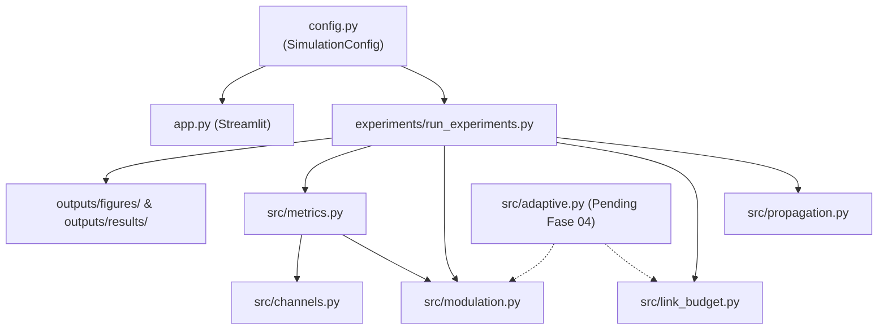

# Arsitektur Sistem — RuralLink

Dokumen teknis ini menjelaskan struktur modul, aliran data ilmiah, kontrak fungsi publik, dan pemisahan antara mesin simulasi (`src/`) dan antarmuka (`app.py`).

## 1. Diagram Arsitektur & Ketergantungan Modul

## 2. Aliran Data Ilmiah & Kontrak Modul

| Modul | Tanggung Jawab | Fungsi / Kelas Publik Utama |
|---|---|---|
| `config.py` | Menyimpan seluruh parameter default & validasi | `SimulationConfig` |
| `src/propagation.py` | Model *Close-In* (CI) path loss & *shadow fading* | `get_ci_parameters`, `fspl_1m_db`, `sample_shadow_fading_db`, `analytical_shadow_margin_db`, `ci_path_loss_db`, `median_path_loss_db`, `stochastic_path_loss_db` |
| `src/link_budget.py` | Daya terima, derau termal, SNR, $E_b/N_0$, laju nominal | `LinkBudgetResult`, `compute_link_budget`, `active_bandwidth_hz`, `power_per_rb_dbm`, `rb_snr_gain_db`, `snr_to_ebn0_db`, `nominal_data_rate_bps`, `spectral_efficiency`, `shannon_capacity_bps` |
| `src/modulation.py` | Konstelasi Gray-coded, BER eksak Cho–Yoon, ambang batas | `bits_per_symbol`, `modulate`, `demodulate`, `get_constellation`, `q_func`, `theoretical_ber_awgn`, `theoretical_ber_rayleigh`, `derive_switching_thresholds` |
| `src/channels.py` | Kanal AWGN, Rayleigh (independent/block), ekualisasi ZF | `awgn_channel`, `rayleigh_fading_gains`, `rayleigh_channel`, `coherent_equalize`, `instantaneous_snr` |
| `src/metrics.py` | Simulasi Monte Carlo *batched*, Wilson CI, batas 3/N | `ErrorMetrics`, `wilson_ci_95`, `compute_error_metrics`, `simulate_ber_point` |
| `src/adaptive.py` | *Reserved untuk Fase 04* (optimasi gabungan S0–S3) | *Belum diimplementasikan* |

## 3. Konvensi Satuan, Seed, & Validasi
- **Pemisahan satuan:** Semua fungsi menggunakan akhiran satuan eksplisit (`_db`, `_dbm`, `_dbi`, `_hz`, `_mhz`, `_m`, `_km`, `_bps`, `_linear`).
- **Reproduksibilitas:** Semua proses acak menggunakan `numpy.random.Generator` (`np.random.default_rng(seed)`) dengan default `seed = 42` di `config.py`.
- **Pemisahan UI dan Engine:** `app.py` hanya memanggil fungsi dari `src/` dan membaca `outputs/`; tidak ada perhitungan fisika yang ditanam langsung di `app.py`.
- **Entrypoint:**
  - Eksperimen: `.venv\Scripts\python.exe -m experiments.run_experiments`
  - Aplikasi Web: `.venv\Scripts\python.exe -m streamlit run app.py`
  - Pengujian: `.venv\Scripts\python.exe -m pytest -q`
