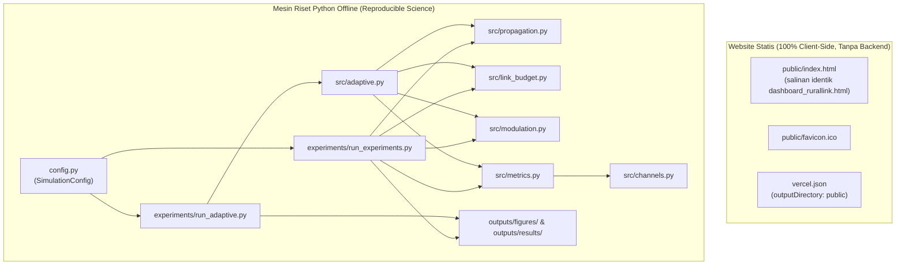

# Arsitektur Sistem — RuralLink

Dokumen teknis ini menjelaskan pemisahan antara **website statis interaktif** (`public/index.html`) dan **mesin riset ilmiah Python** (`src/`, `experiments/`, `outputs/`).

## 1. Diagram Pemisahan Website dan Mesin Riset

## 2. Aliran Data Ilmiah & Kontrak Modul Python

| Modul | Tanggung Jawab | Fungsi / Kelas Publik Utama |
|---|---|---|
| `config.py` | Menyimpan seluruh parameter default & validasi (`tx_power <= 23 dBm`) | `SimulationConfig`, `DEFAULT_CONFIG` |
| `src/propagation.py` | Model *Close-In* (CI) path loss & *shadow fading* | `get_ci_parameters`, `fspl_1m_db`, `sample_shadow_fading_db`, `analytical_shadow_margin_db`, `ci_path_loss_db`, `median_path_loss_db`, `stochastic_path_loss_db` |
| `src/link_budget.py` | Daya terima, derau termal, SNR, $E_b/N_0$, laju nominal | `LinkBudgetResult`, `compute_link_budget`, `active_bandwidth_hz`, `power_per_rb_dbm`, `rb_snr_gain_db`, `snr_to_ebn0_db`, `nominal_data_rate_bps`, `spectral_efficiency`, `shannon_capacity_bps` |
| `src/modulation.py` | Konstelasi Gray-coded, BER eksak Cho–Yoon, ambang batas | `bits_per_symbol`, `modulate`, `demodulate`, `get_constellation`, `q_func`, `theoretical_ber_awgn`, `theoretical_ber_rayleigh`, `derive_switching_thresholds` |
| `src/channels.py` | Kanal AWGN, Rayleigh (independent/block), ekualisasi ZF | `awgn_channel`, `rayleigh_fading_gains`, `rayleigh_channel`, `coherent_equalize`, `instantaneous_snr` |
| `src/metrics.py` | Simulasi Monte Carlo *batched*, Wilson CI, batas 3/N | `ErrorMetrics`, `wilson_ci_95`, `compute_error_metrics`, `simulate_ber_point` |
| `src/adaptive.py` | Optimasi gabungan S0–S3 & R0, keandalan shadowing, validasi MC | `SCENARIOS`, `select_operating_point`, `evaluate_scenario_curves`, `summarize_coverage`, `compare_strategies`, `validate_operating_point` |

## 3. Batas Peran Website vs Python
- **Website Statis (`public/index.html` / `dashboard_rurallink.html`):** Berjalan mandiri di browser memakai JavaScript analitis (*zero backend*, *zero API calls*). Tabel hasil penelitian di Tab 2 memuat ringkasan statis dari `outputs/`, sedangkan grafik interaktif di Tab 1 dihitung langsung secara analitis di browser.
- **Mesin Riset Python (`src/` + `experiments/`):** Satu-satunya sumber reproduksi untuk eksperimen Monte Carlo *bit-level*, realisasi *shared* shadowing + Rayleigh CSI, grafik PNG publikasi, dan dataset CSV di `outputs/`.
- **Konvensi Satuan & Seed Python:** Semua fungsi memakai akhiran satuan eksplisit (`_db`, `_dbm`, `_dbi`, `_hz`, `_mhz`, `_m`, `_km`, `_bps`, `_linear`) dan `np.random.default_rng(seed)` dengan `seed = 42`.
- **Entrypoint:**
  - Website statis: buka `public/index.html` langsung atau `python -m http.server --directory public 8000`
  - Eksperimen dasar: `.venv\Scripts\python.exe -m experiments.run_experiments`
  - Eksperimen adaptif: `.venv\Scripts\python.exe -m experiments.run_adaptive`
  - Pengujian: `.venv\Scripts\python.exe -m pytest -q`
